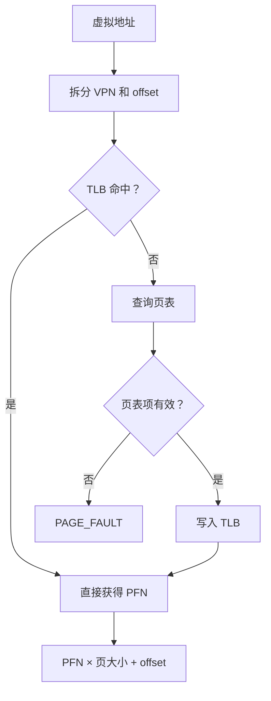

## 周六实验：实现带 LRU 淘汰的 TLB 模拟器

### 1. 前置知识／相关理论

TLB 是位于 CPU 内部的地址翻译缓存，保存近期使用的 `VPN → PFN` 映射。

一次访问的基本流程是：



本实验采用全相联 TLB：任意槽位都能保存任意 VPN。TLB 满时使用 LRU，淘汰最久没有访问的条目。

阅读材料：

- [OSTEP：TLBs](https://pages.cs.wisc.edu/~remzi/OSTEP/vm-tlbs.pdf)
- [OSTEP TLB 教学幻灯片](https://pages.cs.wisc.edu/~remzi/OSTEP/Educators-Slides/Andrea/lecture6-TLB.pdf)
- [xv6 的页表实现 `kernel/vm.c`](https://github.com/mit-pdos/xv6-riscv/blob/riscv/kernel/vm.c)

xv6 的 `walk()` 负责沿页表查找 PTE；xv6 还会在重新加载 `satp` 后执行 `sfence.vma`，使之前缓存的地址翻译不再继续被使用。[GitHub](https://github.com/mit-pdos/xv6-riscv/blob/riscv/kernel/vm.c?utm_source=chatgpt.com)

本实验仍使用：

- 虚拟地址空间：256 字节
- 物理内存：128 字节
- 页大小：16 字节
- VPN 范围：`0..15`
- PFN 范围：`0..7`

### 2. 具体要求

1. 创建 Rust 项目 `tlb-sim`，只使用标准库。

2. 程序接收三个参数：

   - TLB 容量；
   - 页表映射；
   - 待访问的虚拟地址序列。

3. 命令格式为：

```bash
cargo run --quiet -- <capacity> '<vpn:pfn,...>' '<va,...>'
```

4. 每次地址访问需要：

   1. 判断地址是否越界；
   2. 计算 VPN 和页内偏移；
   3. 在 TLB 中查找 VPN；
   4. 命中时更新该条目的最近使用时间；
   5. 未命中时查询页表；
   6. 页表项有效时把映射装入 TLB；
   7. TLB 已满时淘汰最久没有使用的条目；
   8. 组合并输出物理地址。

5. 页表未映射时输出 `PAGE_FAULT`。页故障不能产生新的 TLB 条目。

6. 最后输出：

   - 命中次数；
   - 未命中次数；
   - 页表查询次数；
   - 最终 TLB 内容，顺序为 LRU 到 MRU。

7. 拒绝以下输入：

   - TLB 容量为 `0`；
   - 重复 VPN；
   - VPN 或 PFN 越界；
   - 空地址列表；
   - 非数字参数。

### 3. 验收标准

执行环境：

- Linux、macOS 或 Ubuntu 容器；
- Rust stable；
- 不使用第三方依赖。

在 `tlb-sim` 目录运行：

```bash
cargo run --quiet -- 2 '0:3,1:6,2:1,7:0' '0,16,1,32,17,0,112'
```

预期输出：

```text
va=0 vpn=0 MISS pa=48
va=16 vpn=1 MISS pa=96
va=1 vpn=0 HIT pa=49
va=32 vpn=2 MISS pa=16
va=17 vpn=1 MISS pa=97
va=0 vpn=0 MISS pa=48
va=112 vpn=7 MISS pa=0
stats: hits=1 misses=6 page_walks=6
tlb: 0 7
```

关键时间线如下：

| 访问 | 结果 | 访问后的 TLB（LRU → MRU） |
|---|---|---|
| VPN 0 | miss | `0` |
| VPN 1 | miss | `0 1` |
| VPN 0 | hit | `1 0` |
| VPN 2 | miss，淘汰 1 | `0 2` |
| VPN 1 | miss，淘汰 0 | `2 1` |
| VPN 0 | miss，淘汰 2 | `1 0` |
| VPN 7 | miss，淘汰 1 | `0 7` |

验证页故障：

```bash
cargo run --quiet -- 2 '0:3' '16'
```

预期输出：

```text
va=16 vpn=1 MISS PAGE_FAULT
stats: hits=0 misses=1 page_walks=1
tlb:
```

验证非法容量：

```bash
cargo run --quiet -- 0 '0:3' '0'
```

程序应以非零状态退出，并在标准错误中说明 TLB 容量必须大于 `0`。

交付物：

- 完整 Rust 项目；
- `README.md`；
- 一张手工记录的 LRU 状态变化表；
- 能解释为什么第三次访问 VPN 0 是命中，而第六次访问却是未命中。

### 4. 生成测试用例的完整 Prompt

> 请以当前 `tlb-sim` 文件夹为工作目录，先阅读 `README.md`、`Cargo.toml`、`src/` 和已有测试。只为本实验生成测试代码，不修改或补全模拟器实现。
>
> 程序通过 `cargo run --quiet -- <TLB容量> '<VPN:PFN映射>' '<虚拟地址列表>'` 运行。虚拟地址空间为256字节，物理内存为128字节，页大小为16字节。TLB采用全相联查找和LRU淘汰策略；命中后需要更新最近使用顺序，未命中时查询页表，页表有效才装入TLB，页故障不能装入TLB。输出包括每次访问的HIT或MISS、物理地址或PAGE_FAULT、统计数据以及最终LRU到MRU顺序。
>
> 请使用Rust标准库在`tests/`目录创建集成测试，并确保可以通过`cargo test`执行。覆盖以下情况：首次访问未命中、重复访问命中、命中后更新LRU顺序、容量为1、TLB淘汰、PFN为0、页内首尾偏移、页故障不污染TLB、地址越界、容量为0、重复VPN、越界VPN/PFN、空地址和非数字输入。
>
> 所有期望结果必须根据页大小和LRU规则独立推导，不能先运行当前程序再复制其输出。错误输入检查非零退出状态及有意义的标准错误信息，不要求完整逐字匹配错误文案。不要替我实现`src/`中的TODO。完成后说明运行测试的命令，以及每组测试验证的规则。

### 5. 最原始简单的代码骨架

```bash
cargo new tlb-sim
cd tlb-sim
```

将 `src/main.rs` 替换为：

```rust
use std::{collections::HashMap, env, process};

const PAGE_SIZE: usize = 16;
const VIRTUAL_SIZE: usize = 256;
const PHYSICAL_SIZE: usize = 128;

struct Input {
    capacity: usize,
    page_table: HashMap<usize, usize>,
    addresses: Vec<usize>,
}

struct TlbEntry {
    vpn: usize,
    pfn: usize,
    last_used: usize,
}

struct Tlb {
    capacity: usize,
    entries: Vec<TlbEntry>,
}

enum AccessResult {
    Hit(usize),
    Miss(usize),
    PageFault,
    OutOfRange,
}

fn parse_input(args: &[String]) -> Result<Input, String> {
    // TODO: 解析容量、页表映射和地址序列
    // TODO: 检查重复与越界参数
    todo!()
}

impl Tlb {
    fn new(capacity: usize) -> Self {
        Self {
            capacity,
            entries: Vec::new(),
        }
    }

    fn lookup(&mut self, vpn: usize, now: usize) -> Option<usize> {
        // TODO: 查找 VPN，并在命中时更新 last_used
        todo!()
    }

    fn insert(&mut self, vpn: usize, pfn: usize, now: usize) {
        // TODO: 空间不足时淘汰 last_used 最小的条目
        todo!()
    }

    fn vpn_order(&self) -> Vec<usize> {
        // TODO: 按 LRU 到 MRU 返回 VPN
        todo!()
    }
}

fn access(
    tlb: &mut Tlb,
    page_table: &HashMap<usize, usize>,
    va: usize,
    now: usize,
) -> AccessResult {
    // TODO: 地址检查、TLB 查询、页表查询和物理地址计算
    todo!()
}

fn main() {
    let args: Vec<String> = env::args().collect();
    let input = parse_input(&args).unwrap_or_else(|error| {
        eprintln!("error: {error}");
        process::exit(1);
    });

    let mut tlb = Tlb::new(input.capacity);
    let mut hits = 0;
    let mut misses = 0;
    let mut page_walks = 0;

    for (now, va) in input.addresses.into_iter().enumerate() {
        // TODO: 调用 access、更新统计并输出访问结果
        let _ = (now, va);
    }

    // TODO: 输出统计结果和最终 TLB 顺序
    let _ = (&mut tlb, &mut hits, &mut misses, &mut page_walks);
}
```